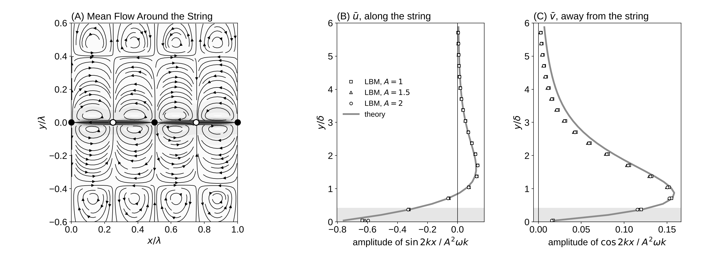

# Experiment 1: Steady Streaming Around a Vibrating String

Date: 2026-10-15. Code: `lbm/` (solver), `lbm/ib.py` (string), `validation/string_checks.py` (runs), `validation/streaming_theory.py` (theory).

## Setup

- A string spans a periodic box, one wavelength lambda = 128 lattice spacings wide. Still walls sit 128 spacings above and below.
- The string carries a standing wave, w = A sin(kx) cos(wt), with A = 1, 1.5 and 2. Its points move only up and down.
- The string is impermeable: fluid at the string moves with the string (no-slip). There is no source.
- Viscosity nu = 1/6 (tau = 1). The period is 679 steps, so the Stokes layer is delta = 6.00 and k delta = 0.295.
- Each run lasts 145 periods. The mean flow is the average over the last 4 periods at fixed points (Eulerian mean).

Reproduce:

    python validation/string_checks.py                 # about 15 min on 2 cores
    python validation/streaming_theory.py              # theory and figure from the saved runs

## Checks

- A flat string sliding along itself gives the exact Stokes layer on each side to 0.4%. The string acts as a plate of half-thickness 0.8 lattice spacings (`string_stokes.png`).
- The mean flow grows as A^2 to within 1%.
- The mean flow matches the small-amplitude theory to 6-7%:

| A | peak mean slip, theory | peak mean slip, LBM | error u | error v |
|---|---|---|---|---|
| 1 | 0.124 | 0.135 | 6.8% | 5.6% |
| 1.5 | 0.124 | 0.135 | 7.0% | 7.1% |
| 2 | 0.124 | 0.134 | 6.2% | 6.4% |

Mean slip is the amplitude of sin(2kx) in u_bar, in units of A^2 w k; it peaks at y = 1.7 delta.

## Result

- Close to the string (below about 0.8 delta) the mean flow runs from the antinodes to the nodes.
- The mean flow leaves the string at the nodes and returns to it at the antinodes. Above about 0.8 delta it runs from the nodes back toward the antinodes, closing one pair of cells per half wavelength. The pattern is mirrored below the string.
- The wall term -<eta du_1/dy> is large on its own but cancels against part of the Reynolds stress. What remains puts the mean jets at the nodes.

## Open

- This is the Eulerian mean. Grains and fluid parcels follow the Lagrangian mean, which adds a drift near the string. Tracer particles are needed for the conveyor question.
