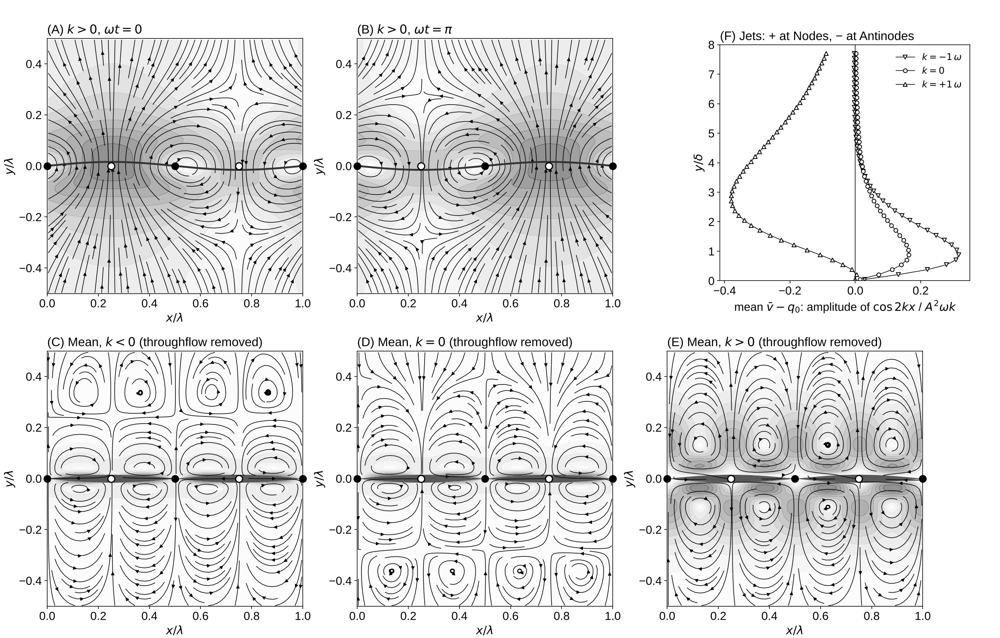
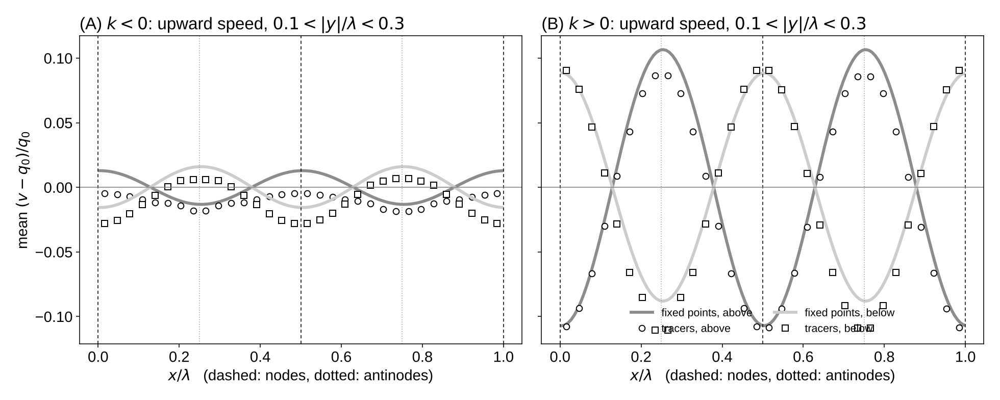

# Experiment 2: Permeable Vibrating String With a Source Below

Date: 2026-10-15. Code: `run.py` in this folder; solver in `lbm/`, open boundaries in `lbm/boundaries.py`.

## Setup

The flat version of the permeable shell in `notes/vibrating_hydrodynamics.tex`.

- Periodic box, one wavelength lambda = 128 wide. The string sits in the middle, 128 lattice spacings from the bottom and from the top.
- Source: the bottom row injects fluid upward at q0 = 0.005. Outlet: the top row is held at fixed pressure. The fluid starts in uniform flow at q0.
- The string carries a standing wave, w = A sin(kx) cos(wt), with A = 2. Its points move only up and down.
- Boundary condition at the string (eq:normal_bc, eq:flux): the fluid moves with the string plus a permeation flow q along the tilted normal,

      u = (0, dw/dt) + q n,   n = (-dw/dx, 1) / sqrt(1 + (dw/dx)^2),   q = q0 + k w.

  So u.n = dw/dt + q, and the tangential velocity matches the string.
- Three runs: k = 0, +w, -w. With k = +-w, k A equals the string speed A w, about 3.7 times q0, so the flow through the string reverses during part of each cycle.
- Viscosity nu = 1/6, Stokes layer delta = 6.0, period 679 steps, 145 periods per run, mean over the last 4 periods.

Reproduce:

    python experiments/02_permeable_string/run.py          # about 15 min on 2 cores
    python experiments/02_permeable_string/run.py --figure # figure only

## Results

Net outflow. The mean flux through lines 30 and 60 spacings above and below the string equals q0 lambda to within 0.03% in all three runs. The vibration and the permeation term k w add nothing to the net outflow, as eq:outflow predicts (Q_out = Q0).

Mean jets. The amplitude of cos(2kx) in the mean vertical flow above the string, minus q0, in units of A^2 w k (panel F). Positive means jets at the nodes, negative means jets at the antinodes. Above the string's reach (y > A) the Eulerian mean flux equals the true net volume transport.

| k | peak jet amplitude | height of peak | jets at |
|---|---|---|---|
| -w | +0.32 | 0.9 delta | nodes, about twice as strong as k = 0 |
| 0 | +0.16 | 0.9 delta | nodes (same as the impermeable string) |
| +w | -0.38 | 2.9 delta | antinodes, with larger cells |

Instantaneous flow (panels A and B, k = +w). At wt = 0 the antinodes bulged outward jet fluid straight out along the radius, and the antinodes pulled inward draw fluid back through the string. Half a cycle later the roles swap.

## Tracers

`tracers.py` carries 4096 fluid tracers through the same flow for 30 cycles, for k = -w and +w (`tracers.mp4`). The tracers start in flat horizontal stripes, and the stripes bend where the fluid moves faster or slower.

    python experiments/02_permeable_string/tracers.py           # about 3 min after the spin-up, 6 min each with it
    python experiments/02_permeable_string/tracers.py --movie   # movie and drift figure from saved tracks

The figure compares the mean upward speed of the tracers (displacement over whole cycles) with the period-averaged speed at fixed points, in a band 0.1 to 0.3 lambda above and below the string.

- k = +w: the tracers rise about 10% faster than q0 above the antinodes and 10% slower above the nodes, as the fixed-point average says. The jets at the antinodes are real transport of fluid, not an artifact of averaging at fixed points.
- Below the string the pattern flips: fluid approaches faster under the nodes. So fluid comes up under the nodes, shifts sideways near the string toward the antinodes, and leaves above the antinodes.
- k = -w: the jets sit close to the string (peak at 0.9 delta) and are weak in this band, about 1-2% of q0, the same size as the scatter of the tracer average.

## What this changes in the theory

The notes predicted mean jets at the nodal lines for k > 0, from the mean sideways flux <J_s> = -(k W0^2 / 4) grad_s(Y^2), which runs toward the nodes. The simulation gives the opposite: k > 0 puts the mean jets at the antinodes, and k < 0 at the nodes. The sideways-flux argument tracks only flow along the shell. It leaves out the mean flow that the oscillating permeation drives through the Reynolds stress and its coupling with the shell motion. A second-order theory with permeation (an extension of `validation/streaming_theory.py`) is needed to settle which term wins.

## Open

- Theory of the mean flow with permeation and a source, to compare with these runs.
- Darcy permeation, q = kappa (p_below - p_above), instead of a prescribed q.
- Tracer statistics within a few delta of the string, where the two averages may differ.
