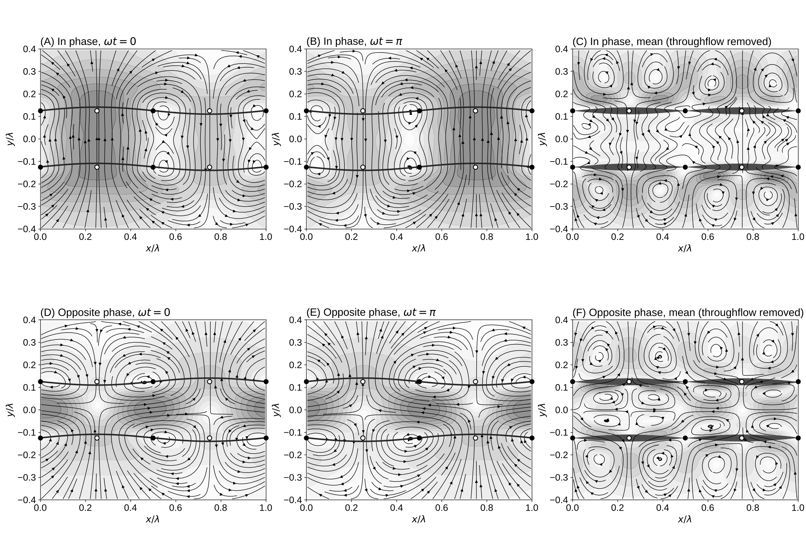

# Experiment 3: Two Parallel Permeable Strings, In Phase and Opposite Phase

Date: 2026-10-15. Code: `two_strings.py` in this folder (reuses the setup of experiment 2).

## Setup

- Same box, source (q0 = 0.005 from below), fixed-pressure outlet and string condition as experiment 2, with k = +w and A = 2.
- Two strings a distance D = lambda/4 = 32 lattice spacings apart (about 5 Stokes-layer thicknesses), nodes lined up:
  lower string w1 = A sin(kx) cos(wt), upper string w2 = A sin(kx) cos(wt + phi).
- Two runs: phi = 0 (in phase) and phi = pi (opposite phase).
- Each run spins up for 145 cycles, then runs 30 more cycles while it carries 4096 tracers and averages the flow.

Reproduce:

    python experiments/03_two_strings/two_strings.py          # about 14 min on 2 cores
    python experiments/03_two_strings/two_strings.py --plot   # figure and movie from saved runs

## Results

Movie: `two_strings.mp4` (tracers start in flat stripes; in phase on the left, opposite phase on the right).

Net outflow. The mean flux through the gap and through lines 60 spacings above and below equals q0 lambda to within 0.15% in both runs.

In phase (panels A-C). The two strings move together, so the gap keeps its width. Fluid in the gap moves as a column: straight up through both strings at the antinode that bulges outward, back down at the antinode pulled inward. Sideways flow in the gap stays small: at most 0.12 q0 at wt = 0, and 0.035 q0 on average. The pair acts as one thick permeable layer.

Opposite phase (panels D-F). The strings move toward and away from each other, so the gap squeezes shut at one antinode while it opens at the next. Fluid in the gap is pumped sideways, from the narrowing part to the widening part: up to 8.9 q0 at wt = 0, about 250 times the in-phase value. The pumping reverses each half cycle, and the mean flow in the gap forms a row of closed cells, with mean sideways speeds up to 0.23 q0. Tracers in the gap sweep sideways about 2.7 times more than in phase, but still rise at q0 on average.

Outside the pair. Above and below, the mean flow matches a single k > 0 string in both runs: jets at the antinodes above (about 14% of q0, 0.25 lambda above the upper string) and faster inflow under the nodes below. The phase between the strings changes the gap, not the flow outside.

## Open

- More strings at smaller spacing, compared with a smoothed (porous-medium) form of the vibrating Navier-Stokes equation.
- Other phase differences (phi = pi/2 makes a travelling squeeze along the gap and may pump fluid in one direction).
