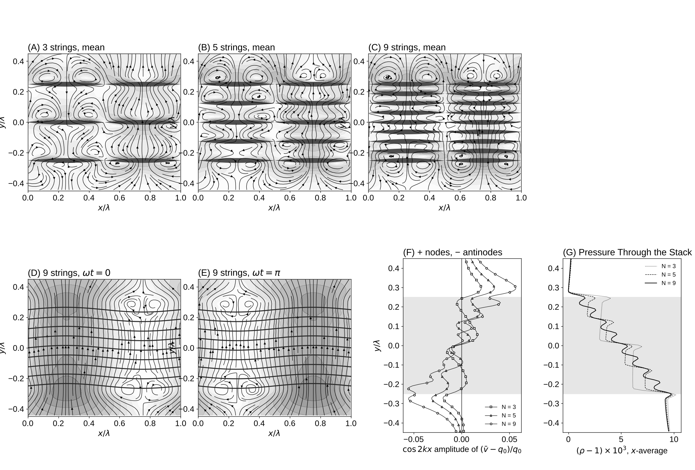

# Experiment 4: A Stack of Permeable Vibrating Strings

Date: 2026-10-15. Code: `stack.py` in this folder.

Toward a string at every height: the shell or string as a smooth vibrating porous medium instead of one surface at one radius.

## Setup

- Same box, source (q0 = 0.005 from below) and fixed-pressure outlet as experiments 2 and 3.
- N strings, all in phase, w = A sin(kx) cos(wt) with A = 2, spread evenly through a band of height lambda/2 in the middle of the box. N = 3, 5, 9 gives spacings of 32, 16 and 8 lattice spacings (5.3, 2.7 and 1.3 Stokes-layer thicknesses).
- Permeation follows the notes' q = kappa (p_in - p_out): each string lets fluid through along its normal at q = kappa (p_below - p_above), with the pressure read from the LBM 3 spacings on each side. q relaxes toward kappa dp over about 50 steps (faster coupling made the 9-string stack unstable). No permeation coefficient k is prescribed; the vibration changes q only through the pressure it creates.
- kappa = N q0 / dp_total, so the whole band always needs the same total pressure drop (density drop 0.01) to pass q0. As N grows, the stack approaches a smooth porous medium with fixed resistance.

Reproduce:

    python experiments/04_string_stack/stack.py --check   # still stack (A = 0), 2 min
    python experiments/04_string_stack/stack.py           # N = 3, 5, 9, about 25 min on 2 cores
    python experiments/04_string_stack/stack.py --plot    # figure and movie from saved runs

## Checks

- Still stack (A = 0, N = 5): the strings pass q = 0.997 q0 and the band drops the density by 0.0100 (expected 0.0100).
- Net outflow: the mean velocity flux equals q0 lambda below the stack and is 1% higher above it in all runs. The 1% is the density drop across the stack: the mass flux rho v is conserved, so v rises by the same 1% where rho is 1% lower.

## Results

Movie: `string_stack.mp4` (9 strings, tracers start in flat stripes).

Pressure (panel G). Each string drops the pressure by one step. With more strings the steps shrink and the profile approaches the straight line of Darcy flow through a uniform porous layer: the string-at-every-height limit.

Inside the stack (panels D, E). The strings hold the fluid between them, so the fluid moves almost straight up and down through the band in columns: up where the stack bulges outward, down where it is pulled in. The mean cells live outside the band.

Mean jets (panels A-C, F). Largest amplitude of cos(2kx) in (v_bar - q0)/q0 within 40 spacings of the band; + means faster flow at the nodes, - at the antinodes.

| N | spacing | above the stack | below the stack |
|---|---|---|---|
| 3 | 32 | +0.020 | -0.019 |
| 5 | 16 | +0.034 | -0.031 |
| 9 | 8 | +0.057 | -0.055 |

- Above the stack the mean flow leaves faster at the nodes; below it, fluid arrives faster under the antinodes.
- The jets are weaker than for one string with a prescribed k = +w (about 10-14% of q0 in experiment 2), and point the other way. Here the pressure sets q, and the pressure-driven modulation of q is about 3.5 times smaller than k A with k = w.
- The jets grow with N and have not settled by N = 9. A denser stack needs a finer grid, since the immersed-boundary string is about 4 spacings wide.

## Open

- N = 17 and 33 on a grid twice as fine (an AWS job), to see whether the jets settle to a limit.
- Derive the smoothed equation for the stack (Darcy-Brinkman with a moving, vibrating matrix) and compare with the dense-stack runs.
- A single Darcy string, to separate the effect of Darcy permeation from the effect of stacking.
