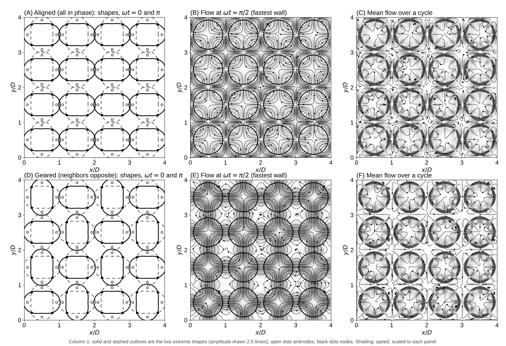

# Experiment 5: Vibrating Circular Cells Locked Together

Date: 2026-10-15. Code: `cells.py` in this folder.

## Setup

- 16 closed strings (cells) of radius R = 20 on a 4 x 4 square lattice, spacing D = 48, in a periodic box, so the gap between neighbors is 8 lattice spacings.
- Each cell vibrates in the oval mode, r = R + A cos(2 theta) cos(wt + phase), with A = 2: four antinodes (two bulge out while two pull in) and four nodes. Fluid inside and outside, no slip, no source, no permeation.
- Same fluid as before: nu = 1/6, Stokes layer delta = 6, period 679 steps; 40 cycles, mean over the last 4.
- Two lockings: aligned (all cells in phase) and geared (checkerboard, neighbors half a cycle apart).

Reproduce:

    python experiments/05_locked_cells/cells.py            # about 5 min on 2 cores
    python experiments/05_locked_cells/cells.py --mode 4   # eight antinodes

## Results

- Aligned: neighbors bulge toward each other at the same moment, so every gap is squeezed from both sides. Fluid squirts out of the gaps at up to 2.0 times the wall speed A w.
- Geared: where one cell bulges, its neighbor pulls in, so each gap keeps nearly the same width and the fluid only shifts across it. The fastest flow is 1.1 A w, about half the aligned value. The cells mesh like gears.
- Mean flow: no net flow across the array in either locking (as the symmetry requires). The mean flow lives in and next to each cell: inside each cell it runs outward toward the antinodes and back in along the nodes, as four small cells. Mean speeds reach 0.026 A w (aligned) and 0.034 A w (geared); between the cells the mean flow is weaker.
