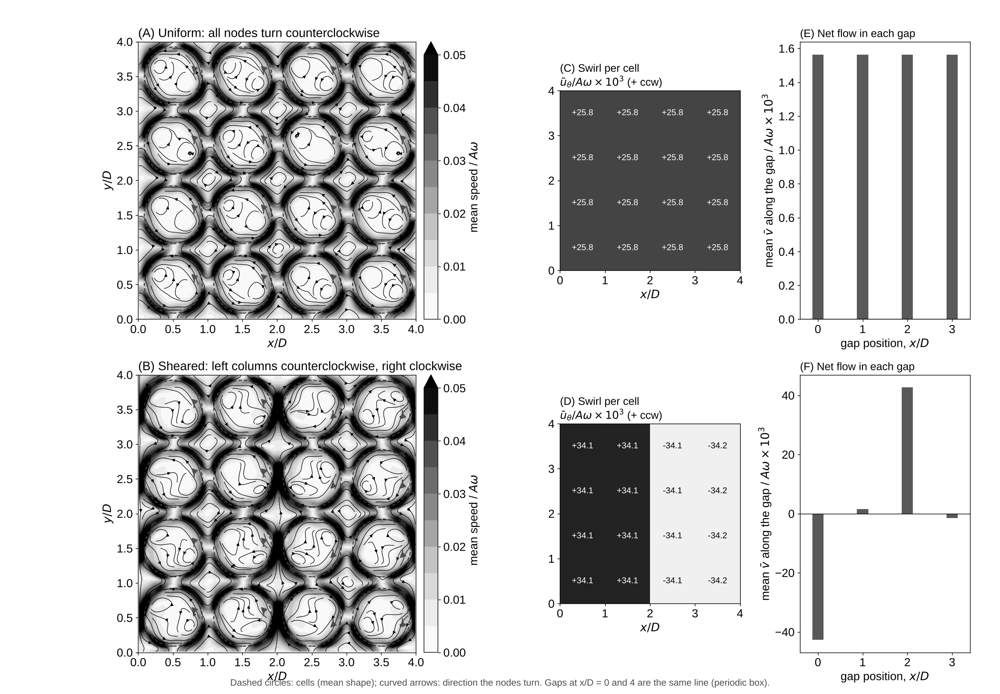

# Experiment 7: Cells Turned by Moving Nodes (Toward Maxwell's Molecular Vortices)

Date: 2026-10-15. Code: `turning.py` in this folder.

## Setup

- The 4 x 4 array of oval-mode cells from experiment 5 (R = 20, spacing D = 48, A = 2), periodic box, no slip, no permeation, no source.
- The nodes move around each cell, as variable tension moves the nodes of the string in the membrane paper:
  r = R + A cos(2 (theta - theta_n(t))) cos(wt), theta_n = s Omega_n t, with Omega_n = 0.25 w / 2 (the nodes advance a quarter of the node spacing each cycle). Wall points move only in and out; only the pattern turns. Here the node motion is prescribed, not yet computed from a tension field.
- Two runs: uniform (all cells s = +1, counterclockwise) and sheared (left two columns counterclockwise, right two clockwise).
- 40 cycles of spin-up, then 30 cycles with 4096 tracers and averaging.

Reproduce:

    python experiments/07_turning_cells/turning.py           # about 12 min on 2 cores
    python experiments/07_turning_cells/turning.py --plot    # figure and movie from saved runs

## Results

Movie: `turning_cells.mp4` (uniform left, sheared right; tracers start in horizontal stripes).

- Each cell gains a steady swirl in the direction its nodes turn: 0.026 A w (uniform) and 0.034 A w (sheared), measured just outside the wall. The standing-wave cells of experiment 5 had none. Moving nodes give each cell a sense of rotation.
- Uniform: neighboring cells turn the same way, so their surfaces move in opposite directions across each gap. The gap fluid stays nearly still on average (0.0016 A w, about 6% of the swirl): Maxwell's idle wheels at rest.
- Sheared: in the two gaps where the turning direction changes, both neighboring surfaces move the same way, and a net current runs along the gap: +0.043 A w at x = 2D and -0.043 A w at x = 0 (the same line as x = 4D). That is 1.25 times the cells' swirl, the size Maxwell's rule (gap speed = mean of the two surface speeds) predicts to within that factor. Where the turning does not change, the gap flow stays at the uniform value.
- The currents appear only where the spin changes across the array, the curl of the spin field: the counterpart of Maxwell's electric current (Part II, Props. IV-V). The total flow through the box stays zero.
- Cells whose neighbors turn the opposite way swirl about 30% faster (0.034 against 0.026 A w): neighbors turning the same way rub against each other across the gap.

## Open

- Compute the node motion from a tension field around each ring with the membrane-paper solver, instead of prescribing it.
- Vary the node speed, from slow drift to full rotation.
- Add permeation and the inflow of experiment 6.
