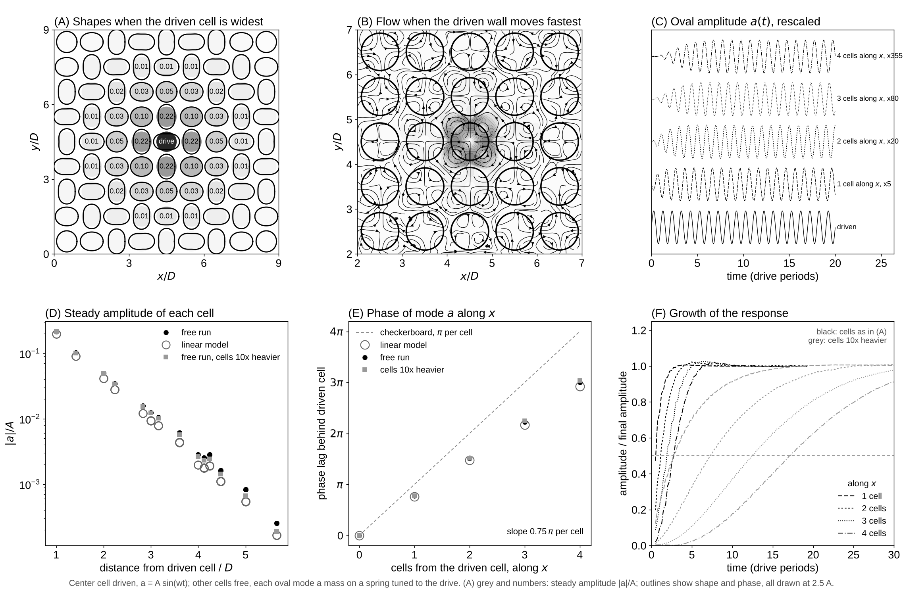

# Experiment 8: One Driven Cell in a Free Array

Date: 2026-10-15. Code: `driven.py` and `analyze.py` in this folder.

## Question

In the geared array of Experiment 5, every cell was driven. Here only the center cell is driven. The other cells are free to vibrate. Does the geared (checkerboard) pattern spread through the array, and how fast?

## Setup

- 81 cells on a 9 x 9 square lattice in a periodic box. Same cells as Experiment 5: radius R = 20, spacing D = 48, gap 8, oval mode m = 2, A = 2, Stokes layer delta = 6.
- Center cell: a = A sin(wt), where r = R + a cos 2theta + b sin 2theta. Mode a bulges toward the four neighbors. Mode b bulges toward the diagonals.
- Every other cell has both modes free. Each mode is a mass on a spring, M a'' + K a = Q, where Q is the force of the fluid on the wall projected on the mode. The cell itself has no damping. All loss is in the fluid.
- Mass M equals the added mass of the fluid (1631 in lattice units, 1.30 rho pi R^2). The spring K makes a cell resonate at the drive frequency when its neighbors are held still.
- Second run: cells 10 times heavier, same tuning.
- tau = 0.65 (nu = 0.05), period 2262 steps. The sound wavelength is then 3 times the box, so the fluid acts as incompressible. In scaled terms the flow matches Experiment 5: delta / R = 0.3, A / R = 0.1, A^2 w / nu = 0.22.

Two kinds of run:

- **impedance**: the center cell is driven and all others are held as still circles. The fluid force on each still cell gives the coupling G(d) from a cell to a cell at lattice offset d. The force on the driven cell gives its added mass and damping c.
- **free**: the other cells move.

A linear lattice model uses only the impedance runs: i w c x_i = sum over j != i of G(i - j) x_j. It predicts the free runs without fitting.

Reproduce:

    python experiments/08_driven_cell/driven.py impedance                 # about 13 min on 2 cores
    python experiments/08_driven_cell/driven.py free --periods 20         # about 11 min
    python experiments/08_driven_cell/driven.py free --periods 40 --mass 10 --tag _m10
    python experiments/08_driven_cell/driven.py impedance --R 10 --n 9 --modes a --tag _R10
    python experiments/08_driven_cell/driven.py impedance --R 40 --n 5 --modes a --tag _R40
    python experiments/08_driven_cell/analyze.py                         # results.json, driven_cell.png

`driven.py` uses a leaner immersed-boundary step (`FastIB`). It gives the same marker forces as `lbm/ib.py` to 0.06% and takes rho = 1 in the interpolation, as the force law there already does.

## Results

### Coupling between cells (impedance run)

- A cell feels its four nearest neighbors and almost nothing else. Scaled by the cell's own damping force w c A, the force on a still nearest neighbor is 0.19. On a diagonal neighbor it is 0.012. Two cells away it is 0.0001.
- Mode b loses energy twice as fast as mode a (c = 8.4 against 4.4). Mode b pushes fluid from one corner to the next through the narrow gaps. Mode a pushes fluid out of the gaps into the open corners.
- Damping of whole lattice patterns of mode a: geared (checkerboard) 1.48, aligned 7.25, stripes 4.44. The geared pattern loses about one fifth as much energy as the aligned one, as Experiment 5 suggested. The geared pattern also carries 680 less added mass per cell, and the aligned one 530 more.

### Free cells

- The pattern does not travel. The amplitude falls by about 4.4 times per cell: 0.22 A next to the driven cell, then 0.049, 0.013, 0.003 along x. The decay length is about 0.67 D.
- Near the driven cell the pattern looks geared. Each neighbor bulges out at nearly the moment the driven cell pulls in. The phase lag grows by 0.75 pi per cell along x, not the pi of a perfect checkerboard. So each cell falls 0.25 pi (an eighth of a cycle) short of the checkerboard. Diagonal cells sit at 0.10 A with a lag of 1.55 pi, two neighbor steps.
- The linear model gives amplitudes within 10 to 30% and phases within 0.05 pi of the free run (panels D and E).
- The b modes stay below 0.002 A everywhere.
- Arrival, the time to reach half the final amplitude: 0.75, 1.25, 2.0, 3.0 periods at 1 to 4 cells. That is about 0.75 periods per cell, or 1.3 D per period.
- Heavier cells (10 x) settle to the same amplitudes and phases (0.213 A next to the driven cell against 0.216 A). They arrive about 6 times later: 2.75, 7.25, 12.5, 17.25 periods, about 4.8 periods per cell. The total mass (cell plus fluid) is 5.5 times larger.

So the fluid sets how far the pattern reaches. The cell mass sets how fast it gets there. At resonance the spring cancels the mass, and only the damping force and the neighbor force remain. Their ratio fixes the step-to-step amplitude ratio. The time for a cell to ring up is (M + m_added) / c, about 0.33 periods for the first run.

### Why the pattern cannot travel without loss

For a lattice wave x_i = exp(i k . r_i) with nearest-neighbor coupling G1, the equation becomes i w c = 2 G1 (cos k_x + cos k_y) at resonance. A real k (a wave that does not decay) needs 4 |Im G1| >= w c. That is the same as zero damping for the geared pattern. A passive fluid always dissipates, so the geared pattern always has some damping and the response always decays. Maxwell's cells were lossless elastic bodies, so his model carried waves without loss.

### Thinner Stokes layers (impedance runs only, linear model for the decay)

Same fluid and delta = 6, cells of radius 10, 20 and 40 (spacing 2.4 R, amplitude 0.1 R).

| delta / R | G1 / (w c) | geared damping / c | aligned damping / c | amplitude at 1, 2, 3 cells | lag per cell |
|---|---|---|---|---|---|
| 0.6 | 0.02 - 0.18 i | 0.27 | 1.72 | 0.22, 0.054, 0.014 | 0.93 pi |
| 0.3 | 0.10 - 0.16 i | 0.34 | 1.65 | 0.20, 0.041, 0.009 | 0.71 pi |
| 0.15 | 0.31 - 0.15 i | 0.39 | 1.56 | 0.24, 0.058, 0.017 | 0.45 pi |

- With thick layers the coupling is almost all viscous (imaginary G1). The response is an almost perfect checkerboard, lag close to pi per cell.
- As the layer thins, the pressure part (real G1) grows fast: 0.02, 0.10, 0.31. The lag per cell drops toward pi/2, so the pattern looks more like an outgoing wave. The decay per cell barely changes (about 4 times).
- With the damping set aside, a real coupling G1 gives a pass band of lattice waves, 2 G1 (cos k_x + cos k_y) = K - w^2 (M + m_added). A cell driven at its own resonance sits in the middle of that band, where the lag is pi / 2 per cell. This matches the trend in the last column. When Re G1 is much larger than w c, the wave decays slowly over many cells. The trend suggests Re G1 reaches w c near delta / R = 0.1 or below. Those runs need R = 60 to 80 here, too large for 2 cores.
- The R = 10 case has the immersed boundary spread over 40% of the radius, so its numbers are rough.

## Caveats

- Each cell keeps its center fixed and has only the two oval modes. No rigid motion, no other modes.
- The spring is tuned with the neighbors held still. Detuning moves the response; the linear model handles any tuning.
- Periodic box of 9 x 9 cells. Images of the driven cell sit 9 cells away, where the response is below 1e-4 A.
- Passive cells only. Cells that drive themselves (self-sustained oscillators) could lock to the driven cell and spread the pattern without decay. That is a different experiment.
