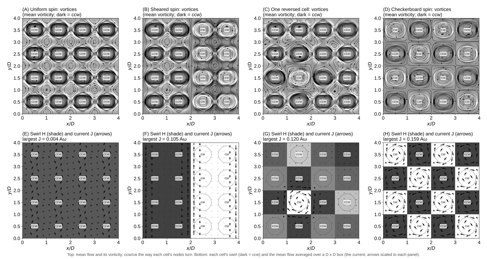
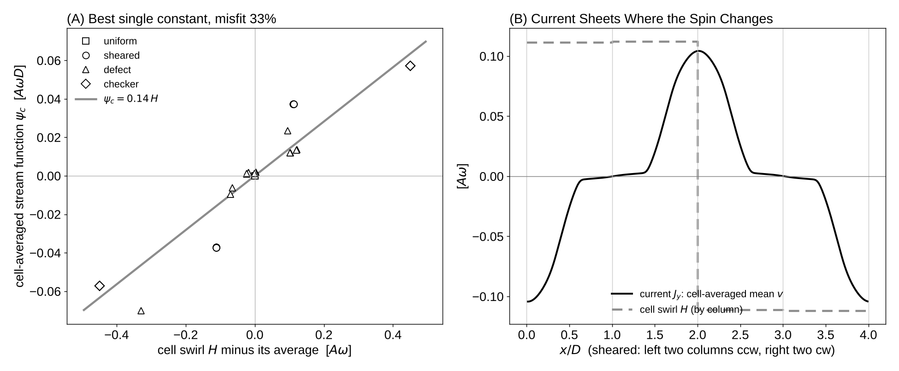
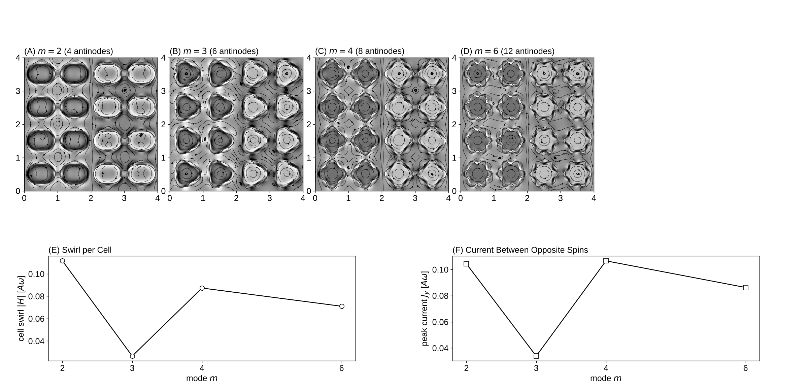

# Experiment 9: Turning Cells as Maxwell's Molecular Vortices

Date: 2026-10-15. Code: `maxwell.py` in this folder (builds on experiment 7).

## Changes from experiment 7

1. Wider gaps: spacing D = 56, radius R = 20, gap 16 lattice spacings (8 at closest approach). Cells drawn at true size.
2. Stronger drive: amplitude A = 4 and nodes moving at full speed (Omega_n = w / m).
3. Longer runs (30 cycles spin-up, then 120 cycles) and a stroboscopic movie: one frame per cycle, so the swing drops out and only the drift shows.

Four spin patterns on the 4 x 4 lattice (oval mode, m = 2): uniform, sheared (left two columns ccw, right two cw), one reversed cell, and checkerboard. Mode sweep: the sheared pattern for m = 2, 3, 4, 6 (40 cycles spin-up, 4 cycles averaged).

Reproduce:

    python experiments/09_maxwell_cells/maxwell.py          # about 70 min on 2 cores
    python experiments/09_maxwell_cells/maxwell.py --plot   # figures and movie from saved runs

## Results

Movies:
- `maxwell_cells_full.mp4` (`movie_full.py`): part 1 shows 6 cycles in real time, with the shells vibrating and their nodes travelling around them; part 2 shows the 120-cycle drift, one frame per cycle, with each shell's vibration range as a grey band.
- `maxwell_cells.mp4`: the drift only, one frame per cycle. In this view every frame catches the shells at the same moment of their cycle, so they look still.

Swirl per cell (mean |H|, in units of the wall speed A w): uniform 0.062, sheared 0.112, one reversed cell 0.092, checkerboard 0.450. The stronger drive raises the uniform swirl from 0.026 (experiment 7) to 0.062. Cells whose neighbors turn the other way swirl faster: in the checkerboard every neighbor pair meshes like gears, and the swirl is about 7 times the uniform value.

The current (mean flow averaged over one cell) takes a different shape for each spin pattern:

- uniform: no current (largest 0.004 A w), Maxwell's idle wheels at rest;
- sheared: two straight current sheets, along the lines where the spin changes, in opposite directions;
- one reversed cell: a current ring around the reversed cell, like the current loop around a single magnet;
- checkerboard: a current loop around every cell.

In each case the current runs where the spin changes, as Maxwell's J proportional to curl H.

Test of one constant (panel A). If J = c curl H held with one constant c, the stream function of the cell-averaged flow would equal c H in every pattern. The best single constant is c = 0.14 (in units of D), with a misfit of 33%. The sign and the place of the current always match curl H, but the size depends on the pattern: the sheared pattern, whose spin changes over two cells, carries relatively more current than the checkerboard, whose spin changes every cell. The fluid answers spin changes over long distances more strongly, so the relation between current and spin is not purely local.

## Mode sweep

| m | antinodes | swirl per cell (A w) | peak current (A w) |
|---|---|---|---|
| 2 | 4 | 0.112 | 0.104 |
| 3 | 6 | 0.026 | 0.034 |
| 4 | 8 | 0.087 | 0.107 |
| 6 | 12 | 0.071 | 0.086 |

- Higher modes give each cell an m-fold pattern of inner eddies; the swirl falls from m = 2 to m = 6, as the mean flow of a higher mode stays in a thinner layer next to the wall (about R/m thick).
- m = 3 is much weaker than both m = 2 and m = 4. This needs a check (a longer run and other node speeds) before it is read as physics.
