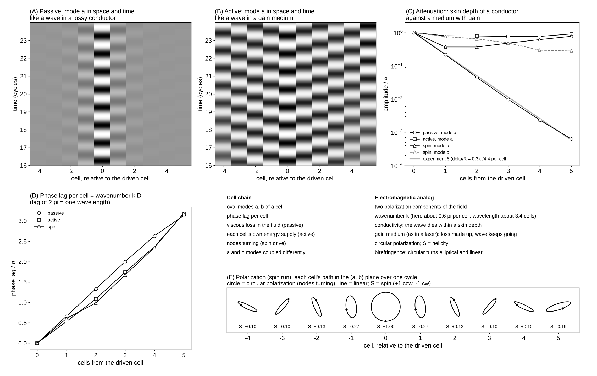

# Experiment 10: Waves Along a Chain of Free Vibrating Cells

Date: 2026-10-15. Code: `chain.py` (runs) and `plots.py` (figure and movie) in this folder. Uses `FastIB` from experiment 8.

Tests the three routes toward lasting waves listed in the project note on Maxwell's molecular vortices.

## Setup

- 10 cells in a row along x, radius R = 40, spacing D = 96 (2.4 R), amplitude A = 4 (0.1 R), in a box 960 x 96, periodic both ways. With one row and periodic y, the runs follow plane waves along x.
- Cell 0 is driven. The wave leaves it in both directions and the two meet at cell 5.
- Each cell has two oval modes, r = R + a cos 2 theta + b sin 2 theta. Free modes are masses on springs: M a'' + K a = Q_a (+ gain). M equals the added mass of a lone cell; K tunes a lone cell (neighbors held) to the drive frequency.
- tau = 0.65 (nu = 0.05), Stokes layer delta = 6, period 2262 steps. Impedance runs (neighbors held) give the tuning: mode a added mass 7627, damping c = 7.25; mode b 4727 and 2.88. Nearest-neighbor coupling of mode a: G1 / (w c) = 0.17 -0.10 i.

Three routes:

1. Thin Stokes layers: delta / R = 0.15 in every run (experiment 8 had 0.3). Passive run: no gain.
2. Self-driven cells (active run): each free mode gets an energy supply that cancels a lone cell's fluid loss and levels off at amplitude A: gain = c (1 - (a^2 + b^2) / A^2) a'. A stand-in for the tension feedback of the self-regulating conveyor.
3. Spin (spin run): cell 0 is driven with its nodes moving around it, a = A sin wt, b = -A cos wt; free cells are self-driven in both modes.

24 cycles per run; the last 4 give amplitudes and phases.

Reproduce:

    python experiments/10_wave_chain/chain.py           # about 30 min on 2 cores
    python experiments/10_wave_chain/plots.py           # figure and movie from saved runs

## Results

Movie: `wave_chain.mp4` (last 12 cycles of each run in real time; cells at true size, shading = fluid speed; below each, mode a of every cell now and its swing over the last cycle).

Amplitude of mode a at 0 to 5 cells from the driven cell (units of A):

| run | amplitude | per cell | phase lag per cell | wavelength |
|---|---|---|---|---|
| passive | 1.000, 0.217, 0.045, 0.010, 0.002, 0.001 | falls 4.6 times | 0.66 pi | 3.0 cells |
| active | 1.000, 0.800, 0.790, 0.761, 0.764, 0.908 | 1.07 | 0.59 pi | 3.4 cells |
| spin (mode a) | 1.000, 0.369, 0.368, 0.481, 0.616, 0.770 | 1.13 | 0.59 pi | 3.4 cells |

Mode b in the spin run: 1.000, 0.755, 0.648, 0.486, 0.297, 0.279.

- Route 1 alone does not save the wave. With delta / R = 0.15 the amplitude still falls about 4.6 times per cell, the same as experiment 8 at delta / R = 0.3. The wave dies within one or two cells, as in a conductor within a skin depth.
- Route 2 does. With each cell making up its own loss, the wave reaches every cell at about 0.8 A and keeps its amplitude. Each cell lags its neighbor by about 0.59 pi, so the wave travels outward with a wavelength of about 3.4 cells and moves about 3.4 D per cycle. The space-time plot (panel B) shows tilted stripes: a travelling wave.
- Route 3: the spin does not travel as spin. The driven cell is circularly polarized (S = +1). Its neighbors are elliptical and the far cells nearly linear, with small spins of alternating sign (|S| below 0.3). The two modes travel differently (mode b falls to about 0.3 A by 5 cells; mode a dips and recovers), so the quarter-cycle offset between them is lost: like circular polarization turning elliptical in a birefringent medium.
- At cell 5 the two outgoing waves meet, so values there mix the two directions.

## Caveats

- The box is about 0.74 of a sound wavelength long, so the fluid is only nearly incompressible over the whole chain.
- The gain is a model of an energy supply, not a computed tension feedback.
- One cell row with periodic y: plane waves only; no spreading in 2D.
